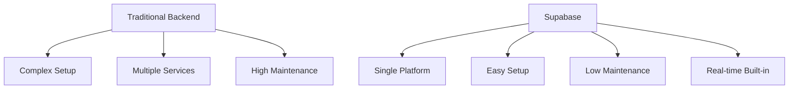
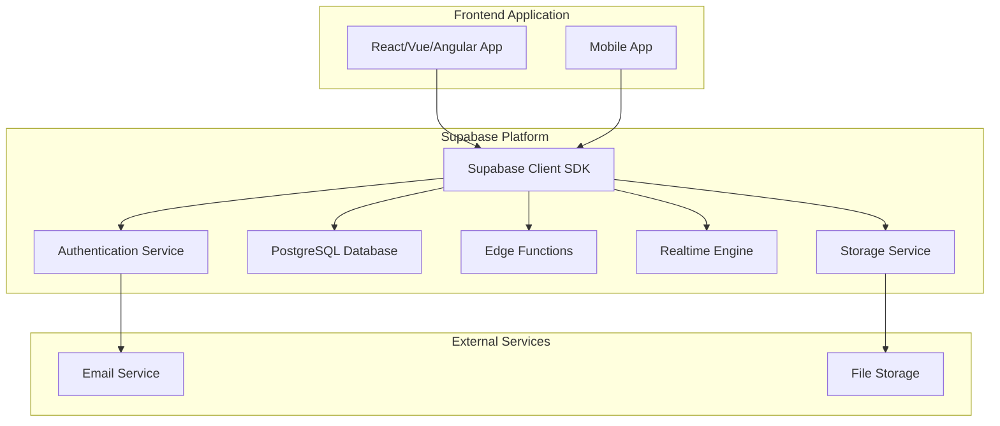
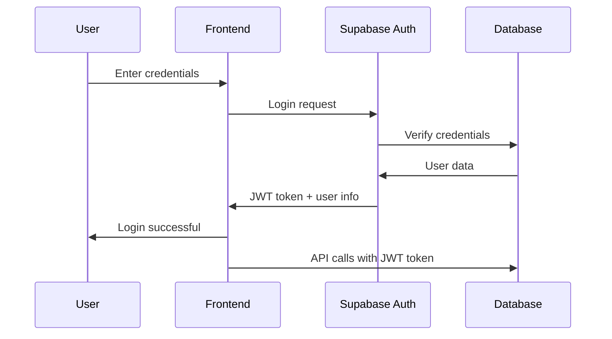
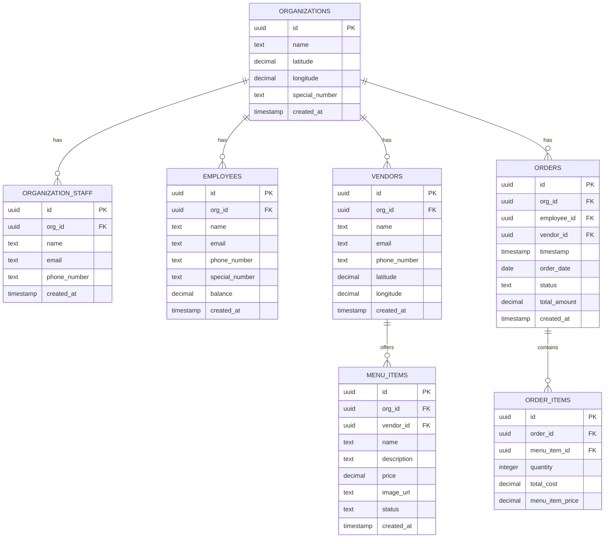
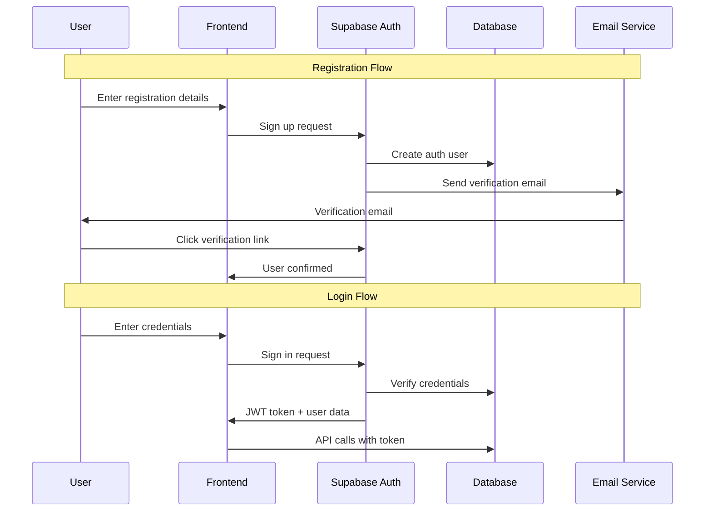
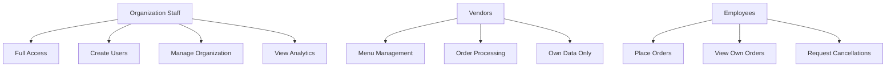
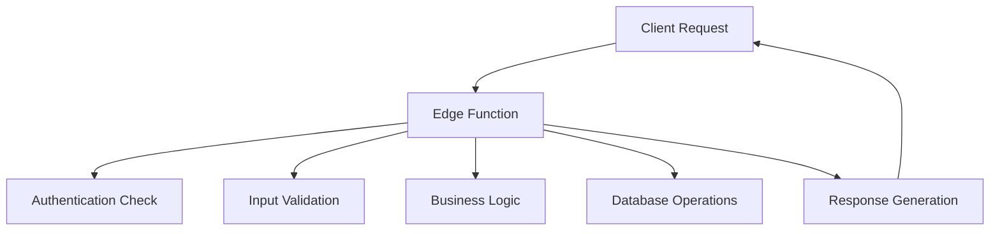
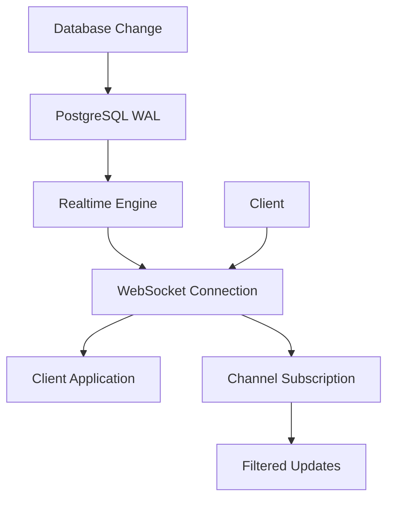
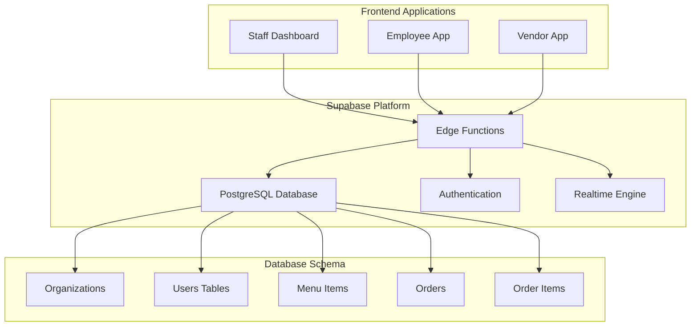
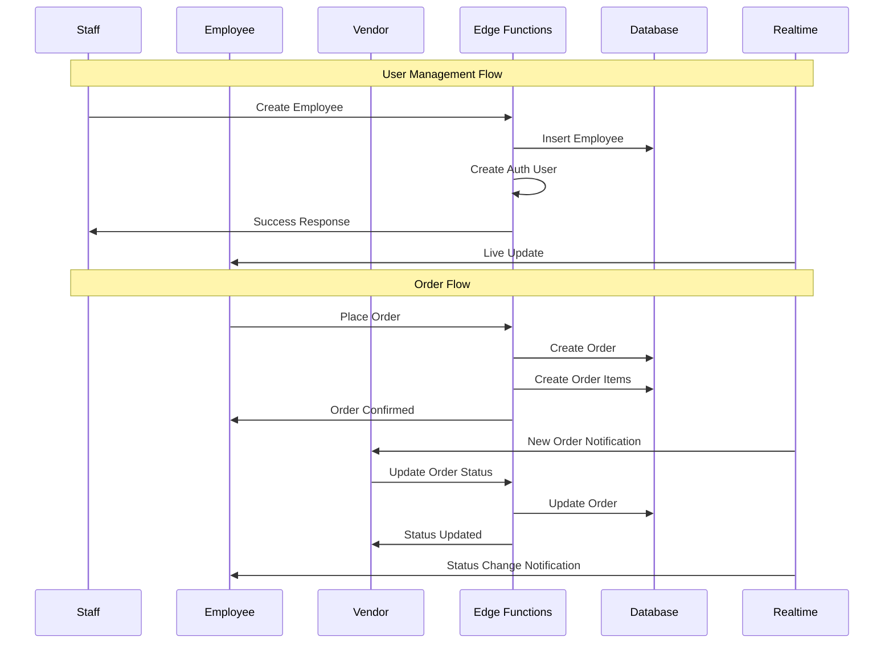

# 🎓 Complete Supabase Backend Course
## Learn Supabase by Building a Real-World Food Ordering System

Welcome to the most comprehensive Supabase course! In this course, you'll learn Supabase by building a complete, production-ready food ordering backend system. By the end, you'll understand not just how to use Supabase, but how to architect real-world applications.

---

## 📚 Table of Contents

### **Part 1: Supabase Fundamentals**
1. [What is Supabase?](#what-is-supabase)
2. [Supabase Architecture](#supabase-architecture)
3. [Core Supabase Services](#core-supabase-services)
4. [Setting Up Your First Project](#setting-up-your-first-project)

### **Part 2: Database Design & Management**
5. [PostgreSQL Fundamentals](#postgresql-fundamentals)
6. [Database Schema Design](#database-schema-design)
7. [Migrations & Version Control](#migrations--version-control)
8. [Row Level Security (RLS)](#row-level-security-rls)

### **Part 3: Authentication & Authorization**
9. [Supabase Auth System](#supabase-auth-system)
10. [JWT Tokens & Sessions](#jwt-tokens--sessions)
11. [Role-Based Access Control](#role-based-access-control)
12. [Custom Authentication Flows](#custom-authentication-flows)

### **Part 4: Edge Functions & API Development**
13. [What are Edge Functions?](#what-are-edge-functions)
14. [Building Your First Edge Function](#building-your-first-edge-function)
15. [API Design Patterns](#api-design-patterns)
16. [Error Handling & Validation](#error-handling--validation)

### **Part 5: Real-time Features**
17. [Supabase Realtime](#supabase-realtime)
18. [Live Data Updates](#live-data-updates)
19. [WebSocket Connections](#websocket-connections)

### **Part 6: Advanced Topics**
20. [Performance Optimization](#performance-optimization)
21. [Security Best Practices](#security-best-practices)
22. [Testing & Quality Assurance](#testing--quality-assurance)
23. [Deployment & Production](#deployment--production)

### **Part 7: Project Deep Dive**
24. [Yuum Backend Architecture](#yuum-backend-architecture)
25. [Complete System Walkthrough](#complete-system-walkthrough)
26. [Code Analysis & Patterns](#code-analysis--patterns)

---

## Part 1: Supabase Fundamentals

### What is Supabase?

**Supabase** is an open-source Firebase alternative that provides:

- **PostgreSQL Database** - A powerful, relational database
- **Authentication** - Built-in user management with JWT tokens
- **Real-time Subscriptions** - Live data updates via WebSockets
- **Edge Functions** - Serverless functions for custom business logic
- **Storage** - File storage and management
- **Dashboard** - Web interface for database management

#### **Why Supabase?**



**Traditional Backend Challenges:**
- Complex server setup and maintenance
- Multiple services to integrate (database, auth, real-time)
- Scaling and deployment complexity
- Security implementation from scratch

**Supabase Benefits:**
- Single platform for all backend needs
- PostgreSQL with real-time capabilities
- Built-in authentication and security
- Serverless functions for custom logic
- Automatic scaling and deployment

### Supabase Architecture



#### **Key Components:**

1. **Supabase Client SDK** - JavaScript/TypeScript library for frontend
2. **Authentication Service** - Handles user registration, login, JWT tokens
3. **PostgreSQL Database** - Your data storage with real-time capabilities
4. **Edge Functions** - Serverless functions for custom business logic
5. **Realtime Engine** - WebSocket connections for live updates
6. **Storage Service** - File upload and management

### Core Supabase Services

#### **1. Database (PostgreSQL)**

PostgreSQL is a powerful, open-source relational database that Supabase uses as its core.

**Key Features:**
- ACID compliance (Atomicity, Consistency, Isolation, Durability)
- Complex queries with JOINs, subqueries, and aggregations
- JSON support for flexible data structures
- Full-text search capabilities
- Extensions for additional functionality

**Example Schema:**
```sql
-- Users table
CREATE TABLE users (
  id UUID PRIMARY KEY DEFAULT gen_random_uuid(),
  email TEXT UNIQUE NOT NULL,
  name TEXT NOT NULL,
  created_at TIMESTAMP WITH TIME ZONE DEFAULT NOW()
);

-- Orders table with foreign key relationship
CREATE TABLE orders (
  id UUID PRIMARY KEY DEFAULT gen_random_uuid(),
  user_id UUID REFERENCES users(id),
  total_amount DECIMAL(10,2),
  status TEXT DEFAULT 'pending',
  created_at TIMESTAMP WITH TIME ZONE DEFAULT NOW()
);
```

#### **2. Authentication**

Supabase Auth provides:
- User registration and login
- Email verification
- Password reset
- Social logins (Google, GitHub, etc.)
- JWT token management
- Row Level Security integration

**Authentication Flow:**


#### **3. Edge Functions**

Edge Functions are serverless functions that run on Supabase's global edge network.

**Benefits:**
- Serverless (no server management)
- Global deployment (low latency)
- TypeScript/JavaScript support
- Direct database access
- Custom business logic

**Example Edge Function:**
```typescript
// functions/process-order/index.ts
import { createClient } from 'https://esm.sh/@supabase/supabase-js@2'

Deno.serve(async (req) => {
  const supabase = createClient(
    Deno.env.get('SUPABASE_URL')!,
    Deno.env.get('SUPABASE_SERVICE_ROLE_KEY')!
  )
  
  const { order_id } = await req.json()
  
  // Custom business logic
  const { data, error } = await supabase
    .from('orders')
    .update({ status: 'processing' })
    .eq('id', order_id)
  
  return new Response(JSON.stringify({ success: !error }))
})
```

#### **4. Realtime**

Supabase Realtime enables live data synchronization using WebSockets.

**Use Cases:**
- Live chat applications
- Real-time notifications
- Collaborative editing
- Live dashboards
- Order status updates

**Example:**
```javascript
// Subscribe to order updates
const subscription = supabase
  .channel('orders')
  .on('postgres_changes', {
    event: 'UPDATE',
    schema: 'public',
    table: 'orders',
    filter: `id=eq.${orderId}`
  }, (payload) => {
    console.log('Order updated:', payload.new)
    updateOrderStatus(payload.new.status)
  })
  .subscribe()
```

### Setting Up Your First Project

#### **Step 1: Create Supabase Account**

1. Go to [supabase.com](https://supabase.com)
2. Sign up with GitHub, Google, or email
3. Create a new project
4. Choose your organization and project name

#### **Step 2: Project Configuration**

```bash
# Install Supabase CLI
npm install -g supabase

# Initialize project
supabase init

# Link to your remote project
supabase link --project-ref your-project-ref

# Start local development
supabase start
```

#### **Step 3: Environment Variables**

```bash
# .env.local
SUPABASE_URL=your-project-url
SUPABASE_ANON_KEY=your-anon-key
SUPABASE_SERVICE_ROLE_KEY=your-service-role-key
```

#### **Step 4: Install Client SDK**

```bash
npm install @supabase/supabase-js
```

```javascript
// lib/supabase.js
import { createClient } from '@supabase/supabase-js'

const supabaseUrl = process.env.NEXT_PUBLIC_SUPABASE_URL
const supabaseKey = process.env.NEXT_PUBLIC_SUPABASE_ANON_KEY

export const supabase = createClient(supabaseUrl, supabaseKey)
```

---

## Part 2: Database Design & Management

### PostgreSQL Fundamentals

#### **Data Types**

```sql
-- Text types
TEXT          -- Variable length text
VARCHAR(255)  -- Variable length with limit
CHAR(10)      -- Fixed length

-- Numeric types
INTEGER       -- Whole numbers
BIGINT        -- Large whole numbers
DECIMAL(10,2) -- Fixed precision decimal
REAL          -- Single precision float
DOUBLE PRECISION -- Double precision float

-- Date/Time types
TIMESTAMP WITH TIME ZONE  -- Date and time with timezone
DATE                     -- Date only
TIME                     -- Time only

-- Boolean
BOOLEAN      -- true/false

-- UUID
UUID         -- Universally unique identifier

-- JSON
JSON         -- JSON data
JSONB        -- Binary JSON (faster queries)
```

#### **Primary Keys and Foreign Keys**

```sql
-- Primary Key (unique identifier)
CREATE TABLE users (
  id UUID PRIMARY KEY DEFAULT gen_random_uuid(),
  email TEXT UNIQUE NOT NULL
);

-- Foreign Key (relationship)
CREATE TABLE orders (
  id UUID PRIMARY KEY DEFAULT gen_random_uuid(),
  user_id UUID REFERENCES users(id) ON DELETE CASCADE,
  total_amount DECIMAL(10,2)
);
```

#### **Indexes for Performance**

```sql
-- Create index for faster queries
CREATE INDEX idx_orders_user_id ON orders(user_id);
CREATE INDEX idx_orders_status ON orders(status);
CREATE INDEX idx_orders_created_at ON orders(created_at);

-- Composite index
CREATE INDEX idx_orders_user_status ON orders(user_id, status);
```

### Database Schema Design

#### **Design Principles**

1. **Normalization** - Reduce data redundancy
2. **Referential Integrity** - Maintain data consistency
3. **Performance** - Optimize for common queries
4. **Scalability** - Design for growth

#### **Yuum Backend Schema**



#### **Schema Explanation**

**Organizations Table:**
- Multi-tenant architecture
- Each organization is isolated
- Contains location data for geospatial queries

**User Tables (Staff, Employees, Vendors):**
- Separate tables for different user types
- Role-based access control
- Each user belongs to one organization

**Menu Items:**
- Vendors can have multiple menu items
- Status field for availability control
- Price and description for display

**Orders & Order Items:**
- Orders contain multiple items
- Calculated totals for reporting
- Status tracking for workflow

### Migrations & Version Control

#### **What are Migrations?**

Migrations are version-controlled database changes that allow you to:
- Track database schema changes
- Deploy changes consistently across environments
- Rollback changes if needed
- Collaborate with team members

#### **Migration Structure**

```sql
-- migrations/20241201000001_create_enums.sql
-- Create custom types for better data validation
CREATE TYPE user_role AS ENUM ('organization_staff', 'employee', 'vendor');
CREATE TYPE order_status AS ENUM ('placed', 'preparing', 'prepared', 'given', 'cancelled', 'cancel_requested');
CREATE TYPE menu_item_status AS ENUM ('active', 'inactive');
```

```sql
-- migrations/20241201000002_create_tables.sql
-- Create all tables with proper relationships
CREATE TABLE organizations (
  id UUID PRIMARY KEY DEFAULT gen_random_uuid(),
  name TEXT NOT NULL,
  latitude DECIMAL(10, 8),
  longitude DECIMAL(11, 8),
  special_number TEXT UNIQUE,
  created_at TIMESTAMP WITH TIME ZONE DEFAULT NOW()
);

CREATE TABLE organization_staff (
  id UUID PRIMARY KEY DEFAULT gen_random_uuid(),
  org_id UUID NOT NULL REFERENCES organizations(id) ON DELETE CASCADE,
  name TEXT NOT NULL,
  email TEXT UNIQUE NOT NULL,
  phone_number TEXT,
  created_at TIMESTAMP WITH TIME ZONE DEFAULT NOW()
);

-- ... more tables
```

#### **Migration Commands**

```bash
# Create new migration
supabase migration new create_orders_table

# Apply migrations
supabase db push

# Reset database
supabase db reset

# Generate types
supabase gen types typescript --local > types/database.ts
```

### Row Level Security (RLS)

#### **What is RLS?**

Row Level Security is a PostgreSQL feature that restricts which rows users can access based on policies.

#### **Enabling RLS**

```sql
-- Enable RLS on tables
ALTER TABLE organizations ENABLE ROW LEVEL SECURITY;
ALTER TABLE employees ENABLE ROW LEVEL SECURITY;
ALTER TABLE orders ENABLE ROW LEVEL SECURITY;
```

#### **Creating Policies**

```sql
-- Organizations: Users can only see their own organization
CREATE POLICY "Users can view own organization" ON organizations
  FOR SELECT USING (
    id IN (
      SELECT org_id FROM organization_staff WHERE auth.uid() = id
      UNION
      SELECT org_id FROM employees WHERE auth.uid() = id
      UNION
      SELECT org_id FROM vendors WHERE auth.uid() = id
    )
  );

-- Employees: Staff can manage employees in their organization
CREATE POLICY "Staff can manage employees" ON employees
  FOR ALL USING (
    org_id IN (
      SELECT org_id FROM organization_staff WHERE auth.uid() = id
    )
  );

-- Orders: Users can only see orders from their organization
CREATE POLICY "Users can view organization orders" ON orders
  FOR SELECT USING (
    org_id IN (
      SELECT org_id FROM organization_staff WHERE auth.uid() = id
      UNION
      SELECT org_id FROM employees WHERE auth.uid() = id
      UNION
      SELECT org_id FROM vendors WHERE auth.uid() = id
    )
  );
```

#### **Policy Types**

1. **SELECT** - Read access
2. **INSERT** - Create access
3. **UPDATE** - Modify access
4. **DELETE** - Remove access
5. **ALL** - All operations

---

## Part 3: Authentication & Authorization

### Supabase Auth System

#### **Authentication Flow**



#### **User Management**

```javascript
// User registration
const { data, error } = await supabase.auth.signUp({
  email: 'user@example.com',
  password: 'password123',
  options: {
    data: {
      name: 'John Doe',
      role: 'employee'
    }
  }
})

// User login
const { data, error } = await supabase.auth.signInWithPassword({
  email: 'user@example.com',
  password: 'password123'
})

// User logout
const { error } = await supabase.auth.signOut()

// Get current user
const { data: { user } } = await supabase.auth.getUser()
```

### JWT Tokens & Sessions

#### **What are JWT Tokens?**

JWT (JSON Web Token) is a compact, URL-safe token that contains:
- **Header** - Algorithm and token type
- **Payload** - User data and claims
- **Signature** - Verification signature

#### **JWT Structure**

```json
{
  "header": {
    "alg": "HS256",
    "typ": "JWT"
  },
  "payload": {
    "sub": "user-uuid",
    "email": "user@example.com",
    "role": "employee",
    "org_id": "org-uuid",
    "iat": 1640995200,
    "exp": 1640998800
  },
  "signature": "signature_hash"
}
```

#### **Token Management**

```javascript
// Access token (short-lived, 1 hour)
const accessToken = data.session.access_token

// Refresh token (long-lived, 30 days)
const refreshToken = data.session.refresh_token

// Automatic token refresh
supabase.auth.onAuthStateChange((event, session) => {
  if (event === 'TOKEN_REFRESHED') {
    console.log('Token refreshed:', session.access_token)
  }
})
```

### Role-Based Access Control

#### **User Roles in Yuum Backend**

```typescript
type UserRole = 'organization_staff' | 'employee' | 'vendor'

interface User {
  id: string
  email: string
  role: UserRole
  org_id: string
  user_id: string
}
```

#### **Role Permissions**



#### **Implementation in Edge Functions**

```typescript
// functions/create_employee/index.ts
const authResult = await authenticateUser(authHeader)

if (!authResult.success || !authResult.user) {
  return createErrorResponse('Authentication failed', 401)
}

// Check if user is organization staff
if (authResult.user.role !== 'organization_staff') {
  return createErrorResponse('Only organization staff can create employees', 403)
}
```

### Custom Authentication Flows

#### **Custom User Creation**

```typescript
// functions/create_auth_user/index.ts
const { data: authData, error: authError } = await supabase.auth.admin.createUser({
  email: 'user@example.com',
  password: 'password123',
  email_confirm: true,
  user_metadata: {
    role: 'employee',
    org_id: 'org-uuid',
    name: 'User Name'
  }
})
```

#### **Password Management**

```typescript
// functions/change_password/index.ts
const { error } = await supabase.auth.admin.updateUserById(
  targetUserId,
  { password: newPassword }
)
```

---

## Part 4: Edge Functions & API Development

### What are Edge Functions?

Edge Functions are serverless functions that run on Supabase's global edge network, providing:

- **Serverless** - No server management
- **Global** - Deployed worldwide for low latency
- **TypeScript/JavaScript** - Modern development experience
- **Database Access** - Direct connection to PostgreSQL
- **Custom Logic** - Business logic implementation

#### **Edge Function Architecture**



### Building Your First Edge Function

#### **Function Structure**

```typescript
// functions/hello-world/index.ts
import { serve } from 'https://deno.land/std@0.168.0/http/server.ts'
import { createClient } from 'https://esm.sh/@supabase/supabase-js@2'

const supabaseUrl = Deno.env.get('SUPABASE_URL')!
const supabaseKey = Deno.env.get('SUPABASE_SERVICE_ROLE_KEY')!

serve(async (req) => {
  // Handle CORS
  if (req.method === 'OPTIONS') {
    return new Response('ok', { 
      headers: { 
        'Access-Control-Allow-Origin': '*',
        'Access-Control-Allow-Headers': 'authorization, x-client-info, apikey, content-type'
      } 
    })
  }

  try {
    // Create Supabase client
    const supabase = createClient(supabaseUrl, supabaseKey)
    
    // Get request data
    const { name } = await req.json()
    
    // Business logic
    const message = `Hello, ${name}!`
    
    // Return response
    return new Response(JSON.stringify({ message }), {
      headers: { 'Content-Type': 'application/json' }
    })
    
  } catch (error) {
    return new Response(JSON.stringify({ error: error.message }), {
      status: 500,
      headers: { 'Content-Type': 'application/json' }
    })
  }
})
```

#### **Deployment**

```bash
# Deploy single function
supabase functions deploy hello-world

# Deploy all functions
supabase functions deploy

# Deploy with no JWT verification (public function)
supabase functions deploy register_organization --no-verify-jwt
```

### API Design Patterns

#### **RESTful API Design**

```typescript
// GET /functions/v1/users - List users
// POST /functions/v1/users - Create user
// PUT /functions/v1/users/:id - Update user
// DELETE /functions/v1/users/:id - Delete user
```

#### **Request/Response Patterns**

```typescript
// Standard request interface
interface APIRequest {
  // Request body data
}

// Standard response interface
interface APIResponse {
  success: boolean
  data?: any
  error?: string
  message?: string
}
```

#### **Error Handling Pattern**

```typescript
// functions/shared/utils.ts
export function createErrorResponse(message: string, status: number = 400) {
  return new Response(
    JSON.stringify({ 
      success: false, 
      error: message 
    }),
    { 
      status,
      headers: { 
        'Content-Type': 'application/json',
        ...corsHeaders 
      }
    }
  )
}

export function createSuccessResponse(data: any, message?: string) {
  return new Response(
    JSON.stringify({ 
      success: true, 
      data,
      message 
    }),
    { 
      status: 200,
      headers: { 
        'Content-Type': 'application/json',
        ...corsHeaders 
      }
    }
  )
}
```

### Error Handling & Validation

#### **Input Validation**

```typescript
// Validate required fields
if (!body.email || !body.password) {
  return createErrorResponse('Email and password are required', 400)
}

// Validate email format
const emailRegex = /^[^\s@]+@[^\s@]+\.[^\s@]+$/
if (!emailRegex.test(body.email)) {
  return createErrorResponse('Invalid email format', 400)
}

// Validate UUID format
if (!validateUuid(body.user_id)) {
  return createErrorResponse('Invalid user ID format', 400)
}
```

#### **Database Error Handling**

```typescript
const { data, error } = await supabase
  .from('users')
  .insert(userData)

if (error) {
  if (error.code === '23505') { // Unique constraint violation
    return createErrorResponse('Email already exists', 409)
  }
  if (error.code === '23503') { // Foreign key violation
    return createErrorResponse('Referenced record not found', 400)
  }
  return createErrorResponse('Database error', 500)
}
```

#### **Authentication Error Handling**

```typescript
const authResult = await authenticateUser(authHeader)

if (!authResult.success) {
  if (authResult.error === 'INVALID_TOKEN') {
    return createErrorResponse('Invalid or expired token', 401)
  }
  if (authResult.error === 'MISSING_TOKEN') {
    return createErrorResponse('Authorization header required', 401)
  }
  return createErrorResponse('Authentication failed', 401)
}
```

---

## Part 5: Real-time Features

### Supabase Realtime

#### **What is Realtime?**

Supabase Realtime enables live data synchronization using WebSockets, allowing:
- Live updates when data changes
- Collaborative features
- Real-time notifications
- Live dashboards

#### **Realtime Architecture**



### Live Data Updates

#### **Subscribing to Changes**

```javascript
// Subscribe to all changes on orders table
const subscription = supabase
  .channel('orders')
  .on('postgres_changes', {
    event: '*', // All events (INSERT, UPDATE, DELETE)
    schema: 'public',
    table: 'orders'
  }, (payload) => {
    console.log('Order changed:', payload)
    updateOrderList(payload)
  })
  .subscribe()

// Subscribe to specific order updates
const orderSubscription = supabase
  .channel('order-updates')
  .on('postgres_changes', {
    event: 'UPDATE',
    schema: 'public',
    table: 'orders',
    filter: `id=eq.${orderId}`
  }, (payload) => {
    console.log('Order status updated:', payload.new.status)
    updateOrderStatus(payload.new.status)
  })
  .subscribe()
```

#### **Event Types**

1. **INSERT** - New record created
2. **UPDATE** - Record modified
3. **DELETE** - Record removed
4. **ALL** - Any change

#### **Filtering Updates**

```javascript
// Filter by organization
const orgSubscription = supabase
  .channel('org-orders')
  .on('postgres_changes', {
    event: 'INSERT',
    schema: 'public',
    table: 'orders',
    filter: `org_id=eq.${orgId}`
  }, (payload) => {
    addNewOrder(payload.new)
  })
  .subscribe()

// Filter by user role
const userOrdersSubscription = supabase
  .channel('user-orders')
  .on('postgres_changes', {
    event: '*',
    schema: 'public',
    table: 'orders',
    filter: `employee_id=eq.${userId}`
  }, (payload) => {
    handleOrderUpdate(payload)
  })
  .subscribe()
```

### WebSocket Connections

#### **Connection Management**

```javascript
// Connection status
supabase.realtime.onOpen(() => {
  console.log('Realtime connection opened')
})

supabase.realtime.onClose(() => {
  console.log('Realtime connection closed')
})

supabase.realtime.onError((error) => {
  console.error('Realtime error:', error)
})
```

#### **Channel Management**

```javascript
// Create channel
const channel = supabase.channel('orders')

// Subscribe to channel
channel.subscribe((status) => {
  if (status === 'SUBSCRIBED') {
    console.log('Successfully subscribed to orders channel')
  }
})

// Unsubscribe
channel.unsubscribe()

// Remove channel
supabase.removeChannel(channel)
```

---

## Part 6: Advanced Topics

### Performance Optimization

#### **Database Optimization**

```sql
-- Create indexes for frequently queried columns
CREATE INDEX CONCURRENTLY idx_orders_employee_id ON orders(employee_id);
CREATE INDEX CONCURRENTLY idx_orders_status ON orders(status);
CREATE INDEX CONCURRENTLY idx_orders_created_at ON orders(created_at);

-- Composite indexes for complex queries
CREATE INDEX CONCURRENTLY idx_orders_employee_status ON orders(employee_id, status);
CREATE INDEX CONCURRENTLY idx_orders_org_date ON orders(org_id, order_date);
```

#### **Query Optimization**

```typescript
// Efficient query with specific columns
const { data, error } = await supabase
  .from('orders')
  .select('id, status, total_amount, created_at')
  .eq('employee_id', userId)
  .order('created_at', { ascending: false })
  .limit(10)

// Use joins instead of multiple queries
const { data, error } = await supabase
  .from('orders')
  .select(`
    id,
    status,
    total_amount,
    employees!inner(name, email),
    vendors!inner(name)
  `)
  .eq('org_id', orgId)
```

#### **Caching Strategies**

```typescript
// Cache frequently accessed data
const cacheKey = `menu_items_${vendorId}`
let menuItems = localStorage.getItem(cacheKey)

if (!menuItems) {
  const { data } = await supabase
    .from('menu_items')
    .select('*')
    .eq('vendor_id', vendorId)
    .eq('status', 'active')
  
  menuItems = JSON.stringify(data)
  localStorage.setItem(cacheKey, menuItems)
}
```

### Security Best Practices

#### **Input Sanitization**

```typescript
// Sanitize user input
function sanitizeInput(input: string): string {
  return input
    .trim()
    .replace(/[<>]/g, '') // Remove potential HTML tags
    .substring(0, 255) // Limit length
}

// Validate and sanitize
const sanitizedName = sanitizeInput(body.name)
if (sanitizedName.length < 2) {
  return createErrorResponse('Name must be at least 2 characters', 400)
}
```

#### **SQL Injection Prevention**

```typescript
// Use parameterized queries (Supabase handles this automatically)
const { data, error } = await supabase
  .from('users')
  .select('*')
  .eq('email', userEmail) // Safe - Supabase handles parameterization

// Avoid string concatenation
// DON'T DO THIS:
// const query = `SELECT * FROM users WHERE email = '${userEmail}'`
```

#### **Rate Limiting**

```typescript
// Implement rate limiting in Edge Functions
const rateLimitMap = new Map()

function checkRateLimit(userId: string, limit: number = 100): boolean {
  const now = Date.now()
  const userRequests = rateLimitMap.get(userId) || []
  
  // Remove old requests (older than 1 hour)
  const recentRequests = userRequests.filter((time: number) => now - time < 3600000)
  
  if (recentRequests.length >= limit) {
    return false
  }
  
  recentRequests.push(now)
  rateLimitMap.set(userId, recentRequests)
  return true
}
```

### Testing & Quality Assurance

#### **Unit Testing Edge Functions**

```typescript
// tests/functions/auth_login.test.ts
import { assertEquals } from 'https://deno.land/std@0.168.0/testing/asserts.ts'

Deno.test('auth_login function', async () => {
  const request = new Request('http://localhost:54321/functions/v1/auth_login', {
    method: 'POST',
    headers: { 'Content-Type': 'application/json' },
    body: JSON.stringify({
      email: 'test@example.com',
      password: 'password123',
      action: 'signin'
    })
  })
  
  const response = await handler(request)
  const data = await response.json()
  
  assertEquals(response.status, 200)
  assertEquals(data.success, true)
  assertEquals(typeof data.user, 'object')
})
```

#### **Integration Testing**

```typescript
// tests/integration/order-flow.test.ts
Deno.test('Complete order flow', async () => {
  // 1. Create organization
  const orgResponse = await createOrganization(testOrgData)
  assertEquals(orgResponse.success, true)
  
  // 2. Create employee
  const employeeResponse = await createEmployee(testEmployeeData)
  assertEquals(employeeResponse.success, true)
  
  // 3. Create vendor
  const vendorResponse = await createVendor(testVendorData)
  assertEquals(vendorResponse.success, true)
  
  // 4. Add menu item
  const menuResponse = await addMenuItem(testMenuItemData)
  assertEquals(menuResponse.success, true)
  
  // 5. Place order
  const orderResponse = await placeOrder(testOrderData)
  assertEquals(orderResponse.success, true)
  
  // 6. Update order status
  const statusResponse = await updateOrderStatus(orderResponse.order.id, 'preparing')
  assertEquals(statusResponse.success, true)
})
```

### Deployment & Production

#### **Environment Configuration**

```bash
# Production environment variables
SUPABASE_URL=https://your-project.supabase.co
SUPABASE_ANON_KEY=your-anon-key
SUPABASE_SERVICE_ROLE_KEY=your-service-role-key
SUPABASE_DB_PASSWORD=your-db-password
```

#### **Deployment Pipeline**

```yaml
# .github/workflows/deploy.yml
name: Deploy to Production

on:
  push:
    branches: [main]

jobs:
  deploy:
    runs-on: ubuntu-latest
    steps:
      - uses: actions/checkout@v3
      
      - name: Setup Supabase CLI
        uses: supabase/setup-cli@v1
        
      - name: Deploy functions
        run: supabase functions deploy
        env:
          SUPABASE_ACCESS_TOKEN: ${{ secrets.SUPABASE_ACCESS_TOKEN }}
          
      - name: Run migrations
        run: supabase db push
        env:
          SUPABASE_ACCESS_TOKEN: ${{ secrets.SUPABASE_ACCESS_TOKEN }}
```

#### **Monitoring & Logging**

```typescript
// Add logging to Edge Functions
console.log('Function started:', {
  function: 'place_order',
  timestamp: new Date().toISOString(),
  user_id: authResult.user?.id
})

// Log errors
console.error('Database error:', {
  error: error.message,
  code: error.code,
  function: 'place_order'
})
```

---

## Part 7: Project Deep Dive

### Yuum Backend Architecture

#### **System Overview**

The Yuum Backend is a complete food ordering system built with Supabase, featuring:

- **Multi-tenant Architecture** - Multiple organizations with data isolation
- **Role-based Access Control** - Staff, Employees, and Vendors
- **Real-time Updates** - Live order status and menu changes
- **Complete Order Management** - From placement to delivery
- **Analytics & Reporting** - Sales data and insights
- **Bulk Operations** - CSV import for user management

#### **Architecture Diagram**



#### **Data Flow**



### Complete System Walkthrough

#### **1. Organization Setup**

```typescript
// Step 1: Register Organization
const orgData = {
  org_name: "Acme Corp",
  special_number: "ACME001",
  latitude: 40.7128,
  longitude: -74.0060,
  staff_name: "John Admin",
  staff_email: "admin@acme.com",
  staff_password: "password123",
  staff_phone: "+1234567890"
}

const response = await fetch('/functions/v1/register_organization', {
  method: 'POST',
  headers: { 'Content-Type': 'application/json' },
  body: JSON.stringify(orgData)
})

const result = await response.json()
// Returns: organization, staff, and auth tokens
```

**What happens behind the scenes:**
1. Creates organization record in database
2. Creates first staff member
3. Creates Supabase Auth user
4. Returns JWT token for immediate authentication

#### **2. User Management**

```typescript
// Step 2: Staff creates employees
const employeeData = {
  name: "Jane Employee",
  email: "jane@acme.com",
  password: "password123",
  phone_number: "+1234567891",
  special_number: "EMP001",
  balance: 100.00
}

const response = await fetch('/functions/v1/create_employee', {
  method: 'POST',
  headers: {
    'Authorization': `Bearer ${staffToken}`,
    'Content-Type': 'application/json'
  },
  body: JSON.stringify(employeeData)
})
```

**What happens behind the scenes:**
1. Authenticates staff user
2. Validates staff permissions
3. Creates employee record
4. Creates Supabase Auth user
5. Links auth user to employee record

#### **3. Menu Management**

```typescript
// Step 3: Vendor adds menu items
const menuItemData = {
  name: "Margherita Pizza",
  description: "Classic tomato and mozzarella",
  price: 15.99,
  image_url: "https://example.com/pizza.jpg",
  status: "active"
}

const response = await fetch('/functions/v1/vendor_add_menu_item', {
  method: 'POST',
  headers: {
    'Authorization': `Bearer ${vendorToken}`,
    'Content-Type': 'application/json'
  },
  body: JSON.stringify(menuItemData)
})
```

#### **4. Order Processing**

```typescript
// Step 4: Employee places order
const orderData = {
  vendor_id: "vendor-uuid",
  items: [
    { menu_item_id: "pizza-uuid", quantity: 2 },
    { menu_item_id: "drink-uuid", quantity: 1 }
  ]
}

const response = await fetch('/functions/v1/place_order', {
  method: 'POST',
  headers: {
    'Authorization': `Bearer ${employeeToken}`,
    'Content-Type': 'application/json'
  },
  body: JSON.stringify(orderData)
})
```

**What happens behind the scenes:**
1. Authenticates employee
2. Validates vendor exists and belongs to same organization
3. Validates menu items are available
4. Calculates total amount
5. Checks employee has sufficient balance
6. Creates order and order items
7. Deducts amount from employee balance
8. Triggers real-time update to vendor

#### **5. Order Status Updates**

```typescript
// Step 5: Vendor updates order status
const statusData = {
  order_id: "order-uuid",
  status: "preparing"
}

const response = await fetch('/functions/v1/update_order_status', {
  method: 'POST',
  headers: {
    'Authorization': `Bearer ${vendorToken}`,
    'Content-Type': 'application/json'
  },
  body: JSON.stringify(statusData)
})
```

**Real-time Updates:**
```javascript
// Employee receives live updates
const subscription = supabase
  .channel('order-updates')
  .on('postgres_changes', {
    event: 'UPDATE',
    schema: 'public',
    table: 'orders',
    filter: `id=eq.${orderId}`
  }, (payload) => {
    updateOrderStatus(payload.new.status)
    showNotification(`Order status: ${payload.new.status}`)
  })
  .subscribe()
```

### Code Analysis & Patterns

#### **Authentication Pattern**

```typescript
// functions/shared/auth.ts
export async function authenticateUser(authHeader: string) {
  if (!authHeader) {
    return { success: false, error: 'MISSING_TOKEN' }
  }

  const token = authHeader.replace('Bearer ', '')
  
  const supabase = createClient(
    Deno.env.get('SUPABASE_URL')!,
    Deno.env.get('SUPABASE_ANON_KEY')!
  )

  const { data: { user }, error } = await supabase.auth.getUser(token)
  
  if (error || !user) {
    return { success: false, error: 'INVALID_TOKEN' }
  }

  // Get user role and organization from user metadata
  const userRole = user.user_metadata?.role
  const orgId = user.user_metadata?.org_id
  
  return {
    success: true,
    user: {
      id: user.id,
      email: user.email,
      role: userRole,
      org_id: orgId,
      user_id: user.user_metadata?.user_id
    }
  }
}
```

#### **Error Handling Pattern**

```typescript
// functions/shared/utils.ts
export function createErrorResponse(message: string, status: number = 400) {
  return new Response(
    JSON.stringify({ 
      success: false, 
      error: message 
    }),
    { 
      status,
      headers: { 
        'Content-Type': 'application/json',
        ...corsHeaders 
      }
    }
  )
}

export function createSuccessResponse(data: any, message?: string) {
  return new Response(
    JSON.stringify({ 
      success: true, 
      data,
      message 
    }),
    { 
      status: 200,
      headers: { 
        'Content-Type': 'application/json',
        ...corsHeaders 
      }
    }
  )
}
```

#### **Database Operation Pattern**

```typescript
// Standard database operation pattern
const { data, error } = await supabase
  .from('table_name')
  .select('columns')
  .eq('condition', value)
  .single()

if (error) {
  if (error.code === 'PGRST116') { // No rows returned
    return createErrorResponse('Record not found', 404)
  }
  return createErrorResponse('Database error', 500)
}

return createSuccessResponse(data)
```

#### **Validation Pattern**

```typescript
// Input validation pattern
function validateRequiredFields(body: any, requiredFields: string[]) {
  for (const field of requiredFields) {
    if (!body[field]) {
      return `Missing required field: ${field}`
    }
  }
  return null
}

function validateEmail(email: string): boolean {
  const emailRegex = /^[^\s@]+@[^\s@]+\.[^\s@]+$/
  return emailRegex.test(email)
}

function validateUuid(uuid: string): boolean {
  const uuidRegex = /^[0-9a-f]{8}-[0-9a-f]{4}-[1-5][0-9a-f]{3}-[89ab][0-9a-f]{3}-[0-9a-f]{12}$/i
  return uuidRegex.test(uuid)
}
```

---

## 🎯 Key Takeaways

### **What You've Learned**

1. **Supabase Fundamentals** - Understanding the platform and its services
2. **Database Design** - Creating efficient, scalable schemas
3. **Authentication & Security** - Implementing secure user management
4. **API Development** - Building robust, well-designed APIs
5. **Real-time Features** - Implementing live data updates
6. **Production Deployment** - Deploying and maintaining applications

### **Best Practices**

1. **Always validate input** - Prevent security vulnerabilities
2. **Use proper error handling** - Provide meaningful error messages
3. **Implement RLS policies** - Secure your data at the database level
4. **Design for scalability** - Plan for growth from the start
5. **Test thoroughly** - Ensure reliability and quality
6. **Monitor performance** - Track and optimize your application

### **Next Steps**

1. **Build your own project** - Apply what you've learned
2. **Explore advanced features** - Storage, advanced queries, etc.
3. **Contribute to open source** - Share your knowledge
4. **Stay updated** - Follow Supabase updates and new features

---

## 🚀 Congratulations!

You've completed the comprehensive Supabase course! You now have the knowledge and skills to:

- ✅ Build complete backend systems with Supabase
- ✅ Design efficient database schemas
- ✅ Implement secure authentication and authorization
- ✅ Create robust APIs with Edge Functions
- ✅ Add real-time features to your applications
- ✅ Deploy and maintain production applications

**Your Supabase journey is just beginning!** 🎉

---

*This course was created to teach you Supabase through building a real-world application. The Yuum Backend serves as a complete example of modern backend development with Supabase.*
